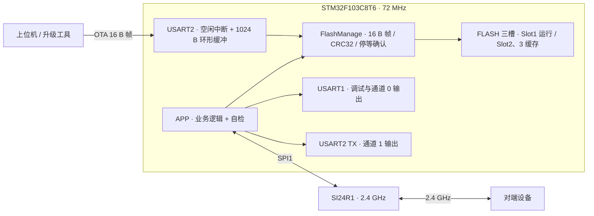
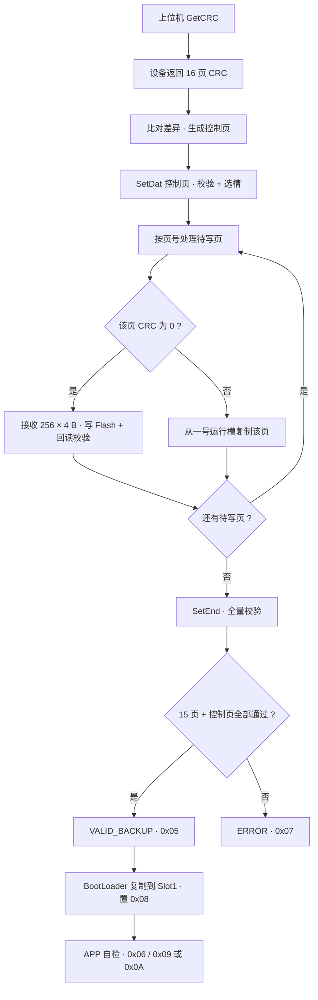

<div align="center">

# STM32F103C8T6 BootLoader + OTA

**三槽 OTA · 2.4G 无线升级 · UART2 透传 · 看门狗回滚**

[](https://www.st.com/en/microcontrollers-microprocessors/stm32f103c8.html)


</div>

---

## 这是什么

一个面向 **STM32F103C8T6** 的三槽 OTA 固件方案：**BootLoader 负责启动决策与安全回滚，APP 负责业务、2.4G 无线收发与 OTA 协议处理**。

设备通过 UART2 接收 16 字节定长 OTA 帧，用 STM32F1 硬件 CRC32 校验每一页，把新固件写入二号/三号缓存槽；BootLoader 在下次启动时把有效备份复制到一号运行区，并在看门狗复位时尝试回滚到上一次已确认版本。

---

## 演示与硬件开源

| 资源 | 链接 | 说明 |
| --- | --- | --- |
| 演示视频 | [YouTube](https://youtu.be/_FmDQ6nCTwE) | 项目功能演示 |
| 硬件开源 | [立创开源广场](https://oshwhub.com/qwqemm/project_pbuzmlz) | 原理图 / PCB / BOM 等硬件资料 |

---

## 为什么是“三槽 + 回滚”

| 设计 | 解决的问题 |
| --- | --- |
| **三槽布局** | 一号槽运行、二/三号槽作为升级目标与有效备份，升级失败不影响当前运行版本 |
| **每页硬件 CRC32** | 15 个 1 KB 程序页逐页校验，控制页带自身 CRC，写入后可回读复核 |
| **16 字节定长帧** | 帧头 `0xA5` + 6 B 类型 + 1 B 编号 + 4 B 数据 + 4 B CRC，解析简单、便于停等确认 |
| **状态机 + 回滚** | `0x05 VALID_BACKUP` 激活、`0x09 CONFIRMED_OK` 回滚、`0x0A CONFIRMED_BAD` 标坏 |
| **双通道 2.4G** | P0 数据从 USART1 输出，P1 数据从 USART2 输出 |

---

## 系统架构



---

## OTA 设计流程



### 启动与回滚策略

1. BootLoader 复位后读取复位源并清除标志；
2. **IWDG 复位**：调用 `FlashManage_HandleWatchdogReset()` 把当前槽与匹配源槽标为 `0x0A`，若存在 `0x09` 回滚槽则复制到一号槽并跳转，否则进入安全模式（TIM1 驱动 LED 闪烁 + 喂狗）；
3. **其他复位**：检查二、三号槽是否存在 `0x05 VALID_BACKUP`，有则复制最新有效备份到一号槽并把相关槽置为 `0x08`，随后跳转 APP；
4. 跳转前依次执行 `__disable_irq()` → `__set_MSP()` → `SCB->VTOR = 0x08004000` → `BX` 到 APP 复位入口。

---

## 当前状态

| 能力 | 状态 | 说明 |
| --- | --- | --- |
| BootLoader 跳转 / 安全模式 | ✅ 已实现 | 向量表重定向、MSP、VTOR、Thumb 跳转 |
| 有效备份激活 | ✅ 已实现 | `0x05` 复制到 Slot1 → `0x08` |
| 看门狗复位回滚 | ✅ 已实现 | `0x0A` 标坏 + `0x09` 回滚 |
| OTA 查询事务 | ✅ 已实现 | `GetCRC` / `GetMID` / `GetSta` + `AckCRC` 停等确认 |
| OTA 写入事务 | ✅ 已实现 | `SetDat` / `SetEnd`、页 CRC 回读、自动选槽 |
| APP 自检 | 🚧 待接入 | `ConfirmRunning()` / `RejectRunning()` 接口已就绪，调用点仍为占位 |
| 断点续传 | 🚧 开发中 | OTA 状态仅在 RAM，掉电后按差异重新开始 |
| 2.4G 双通道 | ✅ 已验证 | P0 → USART1，P1 → USART2 |
| CMake / GCC 构建 | ⚠️ 需修正 | `.ld` 起始地址仍为 `0x8000000` |

---

## 槽状态对照表

| 编码 | 状态 | 含义 | 当前用途 |
| --- | --- | --- | --- |
| `0x00` | EMPTY | 空槽 / 已擦除 | 首次烧录初始化；可作为升级目标 |
| `0x01` | FLASHABLE | 可写入 | 参与选槽判断，可被覆盖 |
| `0x02` | RECEIVING | 正在接收固件 | 接收中；理想情况下掉电后转 PAUSED |
| `0x03` | PAUSED | 升级暂停 | 同 ID 优先续传 |
| `0x04` | VERIFYING | 正在校验 | 等待 SetEnd 校验结果 |
| `0x05` | VALID_BACKUP | 有效备份 | BootLoader 启动时复制到 Slot 1 |
| `0x06` | RUNNING | 当前运行 | Slot 1 的正常状态 |
| `0x07` | ERROR | 升级失败 | 记录失败页，可重新发起升级 |
| `0x08` | RUN_PENDING_CONFIRM | 已复制、待 APP 自检确认 | 等待 ConfirmRunning / RejectRunning |
| `0x09` | RUN_CONFIRMED_OK | 自检确认通过 | 看门狗复位后的回滚候选 |
| `0x0A` | RUN_CONFIRMED_BAD | 自检失败 / 已标坏 | 不再作为回滚候选 |

> 状态记录 Data 的 4 字节顺序为 `[Run_status][Page][Block][Error_code]`；Error 是错误码，不是 Run_status。

### OTA 内部事务阶段

| 阶段 | 含义 |
| --- | --- |
| `IDLE` | 无进行中的 SetDat 会话 |
| `CONTROL` | 正在接收 1 KB 控制页 |
| `PAGE` | 正在接收当前程序页 |
| `WAIT_END` | 所有待写页处理完，等待 SetEnd |

---

## 硬件环境

| 项目 | 说明 |
| --- | --- |
| MCU | STM32F103C8T6，LQFP48，64 KB Flash / 20 KB SRAM |
| 时钟 | 外部 8 MHz 晶振（HSE）+ PLL ×9，系统主频 **72 MHz** |
| 低速时钟 | LSI 打开，供 IWDG 独立看门狗使用 |
| 无线模块 | SI24R1（nRF24L01 兼容），SPI1；2400 MHz、2 Mbps、7 dBm、5 字节地址、动态负载（单包 1~32 字节）；P0=`A5A5A5A5A5`、P1=`C2C2C2C2C2` |
| 调试串口 | USART1，115200 8-N-1 |
| OTA / 数据串口 | USART2，115200 8-N-1，空闲中断接收，1024 字节环形缓冲 |
| 看门狗 | IWDG（LSI），16 分频，重装载 2499，超时约 **1.0 s** |

### 外设与引脚

| 功能 | 外设 | 引脚 |
| --- | --- | --- |
| 2.4G 片选 CSN | GPIO 输出 | PA4 |
| 2.4G 使能 CE | GPIO 输出 | PB0 |
| 2.4G 中断 IRQ | GPIO 输入（上拉） | PB1 |
| LED 指示灯 | GPIO 输出，低电平点亮；APP 由 TIM2、BootLoader 由 TIM1 驱动 | PB12 |
| 2.4G SPI | SPI1 主机，8 bit，CPOL=0 / CPHA=0，分频 8（约 9 Mbit/s） | PA5=SCK，PA6=MISO，PA7=MOSI |
| 调试串口 | USART1 异步 | PA9=TX，PA10=RX |
| OTA 串口 | USART2 异步 | PA2=TX，PA3=RX |
| LED 闪烁定时器 | TIM2（APP）/ TIM1（BootLoader），100 ms 中断 | — |

---

## Flash 分区

| 区域 | 起始地址 | 程序数据 | 控制页 |
| --- | --- | --- | --- |
| BootLoader | `0x08000000` | `0x00004000`（16 KB） | — |
| 一号运行区（APP） | `0x08004000` | `0x08004000~0x08007BFF`（15 KB，Keil IROM1=`0x3C00`） | `0x08007C00~0x08007FFF` |
| 二号区（升级缓存/备份） | `0x08008000` | `0x08008000~0x0800BBFF`（15 KB） | `0x0800BC00~0x0800BFFF` |
| 三号区 | `0x0800C000` | `0x0800C000~0x0800FBFF`（15 KB） | `0x0800FC00~0x0800FFFF` |

### 控制页说明

每个 16 KB 槽的最后 1 KB 为**控制页（Page16）**，其余 15 KB 为程序数据（Page1~Page15）。控制页保存该槽的 `ID`、`Run_status`、`Data_area` 以及 16 个页地址/CRC；写入时先在 RAM 组满完整 1 KB（未使用区域填 `0xFF`），计算控制页自身 CRC 后一次写入。

**槽内页映射**

| 页 | 相对地址 | 用途 |
| --- | --- | --- |
| Page1 ~ Page15 | `0x0000` ~ `0x3800`（步长 `0x0400`） | 15 个 1 KB 程序页 |
| Page16 | `0x3C00` | 控制页自身 |

**控制页字节布局（共 1 KB）**

| 偏移 | 长度 | 字段 | 说明 |
| ---: | ---: | --- | --- |
| `0x00` | 2 B | `ID` | 程序 ID，小端；16 位有效，`0x0000` 无效 |
| `0x02` | 1 B | `Run_status` | 槽状态，取值 `0x00`~`0x0A` |
| `0x03` | 1 B | `Data_area` | 当前 / 最后处理的页号，`0xFF` 表示完成或空闲 |
| `0x04 + 8×(n-1)` | 4 B | `Page[n].Address` | n=1~16；页地址，小端。上位机控制页用相对地址，设备落盘时改写为绝对地址 |
| `0x08 + 8×(n-1)` | 4 B | `Page[n].CRC` | n=1~16；整页 1 KB 的 STM32F1 硬件 CRC32，小端 |
| `0x84` | 892 B | 保留 | 全部 `0xFF` |

> Page16（控制页）地址固定为该槽基址 + `0x3C00`；计算 `Page16.CRC` 时先把该 CRC 字段清 0，再对完整 1 KB 计算硬件 CRC32 并写回。程序页 CRC 为对完整 1 KB（256 个 32 位字）计算的原始硬件 CRC，不做取反。
>
> 代码中 `Page[0]`~`Page[14]` 对应协议 Page1~Page15，`Page[15]` 对应 Page16。

> ⚠️ CubeMX 生成的 GCC 链接脚本 `STM32F103xx_FLASH.ld` 中 APP 的 `FLASH` 起始地址仍为 `0x8000000`，与 Keil 工程的 `0x8004000` 不一致。若用 CMake 构建 APP，需把 FLASH ORIGIN 改为 `0x8004000`、LENGTH 改为 `15K`，否则会覆盖 BootLoader。

---

## 快速开始

### 方式一：Keil MDK-ARM（推荐）

1. 打开 `bootloader/bootloader/MDK-ARM/bootloader.uvprojx`，编译得到 `bootloader.hex`；
2. 打开 `APP/APP/MDK-ARM/APP.uvprojx`，编译得到 `APP.hex` / `APP.bin`；
3. 先烧录 BootLoader（`0x08000000`），再烧录 APP（`0x08004000`）；
4. 也可直接使用仓库中已提交的 `.hex` 固件。

### 方式二：CMake + arm-none-eabi-gcc

需要 CMake 3.22+、Ninja 与 arm-none-eabi-gcc 工具链：

```bash
cmake --preset Debug        # 或 Release
cmake --build --preset Debug
```

生成物位于 `build/Debug/`（已由 `.gitignore` 排除）。当前 CubeMX 工具链设置为 **MDK-ARM V5.32**，CMake 文件保留可用。

---

## OTA 协议速览

固定 16 字节帧：

| 字段 | 长度 | 说明 |
| --- | ---: | --- |
| 帧头 | 1 B | 固定 `0xA5` |
| Type | 6 B | ASCII 命令名，如 `SetDat` |
| Number | 1 B | 帧号 / 页内块号 |
| Data | 4 B | 载荷（状态记录 / CRC / MID 等） |
| CRC32 | 4 B | 前 12 字节的 STM32F1 硬件 CRC32 |

命令集：`GetCRC`、`GetMID`、`SetDat`、`GetSta`、`SetEro`、`SetEnd`、`AckCRC`、`SetCRC`、`SetMID`、`SetSta`。

完整协议与补丁文档：

- [设备端协议完整规范](./doc/设备/01-通讯协议完整规范.md)
- [上位机协议完整规范](./doc/上位机/01-通讯协议完整规范.md)
- [补丁 1.0 · 槽位状态说明](./doc/补丁1.0/设备/01-OTA槽位状态补丁说明.md)

---

## 目录结构

```
.
|-- README.md
|-- .gitignore
|-- ref/                                    # SI24R1 数据手册、板卡原理图
|-- doc/                                    # OTA 协议文档 + 补丁 1.0（上位机 / 设备）
|-- APP/
|   `-- APP/                                # 应用程序工程
|       |-- APP.ioc                         # STM32CubeMX 工程文件
|       |-- Core/                           # main / usart / spi / gpio / iwdg / tim / crc
|       |-- Drivers/                        # CMSIS + STM32F1xx HAL（仅保留用到的文件）
|       |-- hardware/                       # FREQ2_4G / TIM_LED / Uart / MyFLASH / FlashManage
|       |-- MDK-ARM/                        # Keil 工程与固件 APP.hex / APP.bin
|       `-- tmp_manuals/                    # 芯片资料
`-- bootloader/
    `-- bootloader/                         # BootLoader 工程（结构同上）
        |-- Core/                           # main / gpio / iwdg / tim / crc / usart
        |-- hardware/                       # Delay / TIM_LED / Uart / MyFLASH / FlashManage
        `-- MDK-ARM/                        # Keil 工程与固件 bootloader.hex
```

## 工程约定

- 提交源码、CubeMX / Keil 配置、最终固件（`.hex` / `.bin`）与协议文档；
- Keil 编译中间产物、`build/`、`MDK-ARM/RTE/`、`MDK-ARM/DebugConfig/` 等由 `.gitignore` 过滤；
- 对话日志与临时产物统一放在 `tmp/`（已被忽略），详见 `AGENTS.md`。

---

## 已知限制与后续计划

- **复制失败未拦截**：`FlashManage_CopyValidBackup()` 目前忽略 `FlashManage_CopyPage()` 返回值，复制失败仍可能继续跳转；
- **断点续传未闭环**：OTA 状态仅保存在 RAM，掉电后按页 CRC 差异重新开始，而非从块级断点继续；
- **APP 自检未接入**：`ConfirmRunning()` 仍为占位调用，需要接入真实业务自检；
- **收帧健壮性**：`FlashManage_HCC()` 按固定 16 字节偏移解析，尚未处理拆包 / 粘包；
- **空间紧张**：APP 区 15 KB，当前固件约 13.9 KB（约 90%）；
- **GCC 链接脚本**：`STM32F103xx_FLASH.ld` 起始地址待修正为 `0x8004000` / `15K`。

---

## 版本记录

<details>
<summary>展开完整版本记录</summary>

| 日期 | 说明 |
| --- | --- |
| 2026-10-11 | 初始提交：BootLoader + APP 工程 |
| 2026-10-11 | 新增 IWDG 独立看门狗：使能 LSI 时钟，BootLoader / APP 均初始化，APP 主循环定期喂狗 |
| 2026-10-11 | 新增 `README.md` 与 `.gitignore`；将 Keil 编译中间产物等临时文件移出版本控制 |
| 2026-10-11 | CubeMX 改用 CMake 工具链重新生成两个工程，并裁剪未使用的 HAL / CMSIS 库文件 |
| 2026-10-11 | CubeMX 工具链由 CMake 切回 MDK-ARM V5.32，重新生成两个工程的 Keil 工程文件（仅 XML 格式规范化，无实质配置变化） |
| 2026-10-12 | TIM2 改由 CubeMX / HAL 管理（`Core/Src/tim.c`，100 ms 周期），LED 闪烁回调拆分到 `hardware/TIM_LED.c` |
| 2026-10-16 | BootLoader 增加看门狗复位检测与安全模式（TIM1 驱动 LED 闪烁 + 喂狗），非看门狗复位才跳转 APP；新增 `bootloader/hardware` 驱动目录与原理图 `ref/SCH_Schematic1_2026-10-16.pdf` |
| 2026-10-20 | Flash 分区调整为 BootLoader / APP / 二号程序区 / 数据备份区各 16 KB（APP 起始改为 `0x08004000`）；启用 CRC 外设，新增 `MyFLASH`、`FlashManage` 驱动与备份数据结构；IWDG 超时改为约 1.0 s |
| 2026-10-21 | FlashManage 备份写函数重命名为 `FlashManage_BackupWritePage`；新增 0xA5 帧协议处理骨架 `FlashManage_HCC`；`Mydef.h` 补充 `string.h`、`crc.h` 引用 |
| 2026-10-21 | 2.4G 启用 P0/P1 双通道接收（`EN_RXADDR`、`DYNPD` 均为 `0x03`），P1 地址改为 `C2C2C2C2C2`；发送端地址与速率对齐为 2 Mbps / 7 dBm；`RXData_P1` 复用接收缓冲 |
| 2026-10-26 | 2.4G 接收完一帧后按通道选择串口：通道 0 从 USART1 TX 输出，通道 1 从 USART2 TX 输出；接收缓冲扩至 32 字节，支持最大动态负载 |
| 2026-10-26 | UART2 接收缓冲、环形队列、空闲/错误回调与发送封装迁移至 `hardware/Uart.c/.h`；取消 2.4G 上电稳定等待，初始化后直接进入接收模式 |
| 2026-10-26 | UART2 环形缓冲扩至 1024 字节；收到 UART2 数据后只发送一次，随后立即恢复接收模式，发送失败不重试 |
| 2026-11-03 | 新增 `doc/` 上位机与设备 OTA 通讯协议文档各 3 份（完整规范、简明说明、对接测试清单） |
| 2026-11-07 | OTA 查询事务落地（`GetCRC`/`GetMID`/`GetSta` + `AckCRC`），新增 `FlashManage_FirstOnly()` 开机写控制页与 `APP_MID=0x0002`；APP 链接上限调整为 15 KB（`0x3C00`），Keil 构建自动生成 `APP.bin` |
| 2026-11-04 | `FlashManage` 备份页宏同步到新分区：`BackupPageADD1=0x08007C00`、`ADD2=0x0800BC00`、新增 `ADD3=0x0800FC00` |
| 2026-11-08 | 实现 SetDat 主体流程（控制页接收、自动选槽、非零 CRC 页复制、程序页逐块写入与 CRC 回读）与 SetEnd 全量校验/成功失败回报；MyFLASH 新增连续读写 Buffer 接口；`APP_MID` 改为 `0x0003` |
| 2026-11-12 | 2.4G 接收前先读 `FIFO_STATUS`，RX FIFO 为空时直接返回，避免无效读；Keil 的 `fromelf` 生成 `APP.bin` 步骤由 BeforeMake 调整为 AfterMake（确保 bin 与本次 axf 一致） |
| 2026-11-16 | BootLoader 移植 `FlashManage` / `Uart` / `MyFLASH`，新增 USART2，`TIM_LED` 时基由 TIM2 改为 TIM1（配套 TIM1 中断） |
| 2026-11-17 | BootLoader 实现 `VALID_BACKUP` 检查与复制激活；APP 新增 `0x08/0x09/0x0A` 槽状态及 `FlashManage_ConfirmRunning()` / `FlashManage_RejectRunning()` |
| 2026-11-18 | APP 用幂等 `FlashManage_InitIfNeeded()` 替换 `FlashManage_FirstOnly()`，`APP_MID` 改为 `0x0007`；APP 固件重新构建（13,828 B） |
| 2026-11-19 | 控制页写入改为「RAM 组满 1 KB → 计算 Page16 CRC → 擦除后整页一次写入」（APP + BootLoader）；OTA 选槽优先级加入 `0x08`（`0x0A > 0x08 > 0x00 > 0x07/0x01`，保留 `0x05/0x09`） |
| 2026-11-20 | BootLoader 新增 `FlashManage_HandleWatchdogReset()`（IWDG 复位时标坏当前/匹配源槽并回滚 `0x09`）；`APP_MID` 改为 `0x0004`；两份固件重新构建 |

</details>
| 2026-11-21 | README 视觉改版：新增 `assets/` 封面与三槽模型图、系统架构 / OTA 设计流程 Mermaid 图、槽状态对照表；OTA 写入事务标记为已实现 |
| 2026-11-21 | 移除 README 视觉图片与 `assets/` 目录；Flash 分区新增控制页说明、槽内页映射与控制页字节布局表 |
| 2026-11-25 | README 新增演示视频（YouTube）与硬件开源（立创开源广场）链接 |
