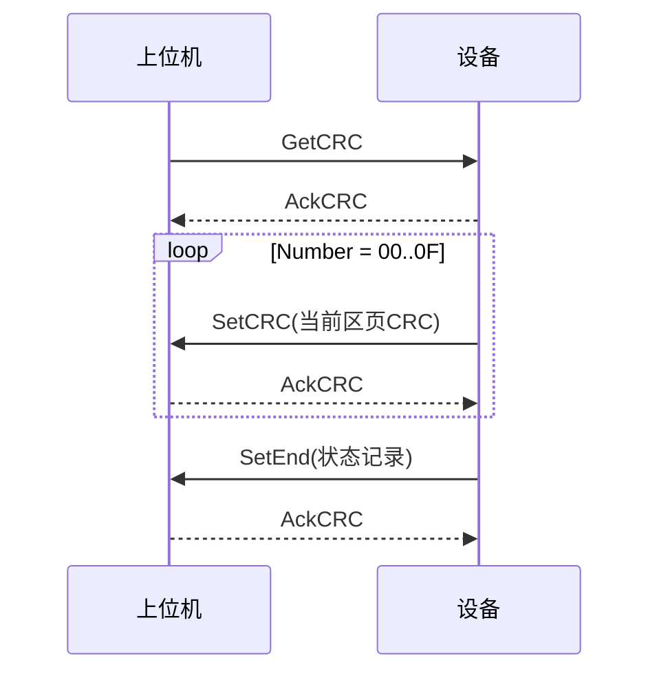
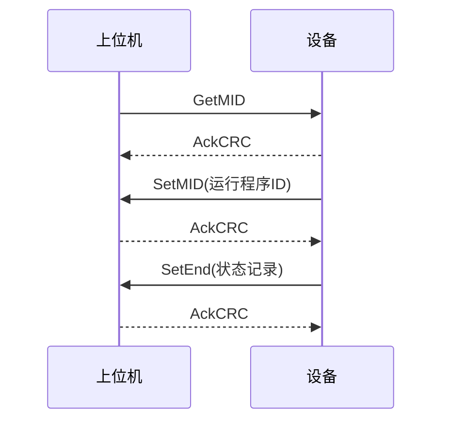
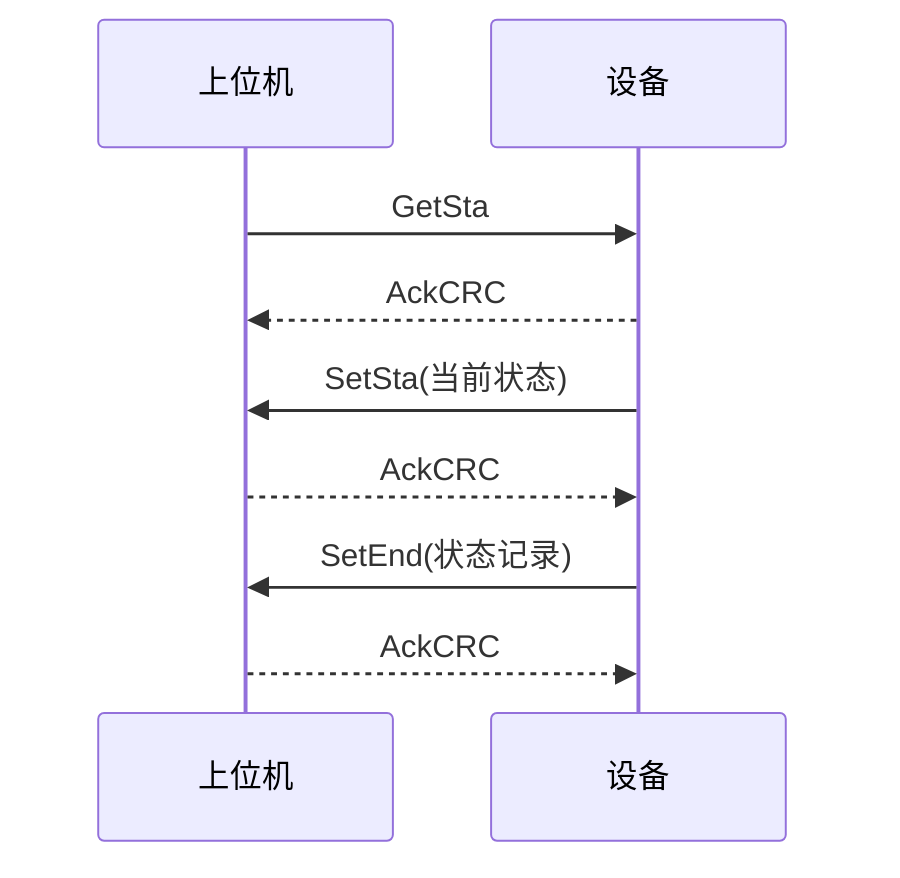

# 上位机通讯协议完整规范

> 协议版本：`OTA-PROTO-1.0`　文档日期：2026-11-03　设备视角：[../设备/01-通讯协议完整规范.md](../设备/01-通讯协议完整规范.md)

本文件从 PC/上位机实现角度定义 OTA 双向协议。上位机必须同时实现发送状态机、接收窗口、500 ms 超时、5 次重试、CRC 计算、页比较和断点记录。

## 上位机必须维护的数据

- 当前运行 ID、目标 ID。
- 当前运行区 16 页 CRC。
- 本地固件 15 个程序页及其 CRC。
- 本次待写页列表，按页号升序。
- 当前页号、当前块号、已确认完成的页。
- 正在进行的事务类型，以及是否已经收到对端的 `AckCRC`。

上位机不得把 UART 一次接收到 16 字节直接视为一帧，也不得在尚未收到 `AckCRC` 时推进块号。

## 1. 文档状态与适用范围

- 协议版本：`OTA-PROTO-1.0`
- 协议日期：2026-11-03
- 状态：目标协议，用于上位机、APP 和后续 BootLoader/刷写流程按同一规则实现。
- 当前 `APP/APP/hardware/FlashManage.c` 只有帧处理骨架，尚未接入主循环，也未完整实现 Flash 写入、槽选择、校验和状态机。本文档描述目标行为，不代表这些能力已经落地。
- 本文档只定义应用层协议。USART2 的 UART 校验、SI24R1 的射频 ACK 与应用层 `AckCRC` 相互独立。

## 2. 物理承载与分帧

| 项目 | 规则 |
| --- | --- |
| USART2 | 115200、8 数据位、无校验、1 停止位；允许一帧被拆成多次读取，也允许多帧粘连 |
| SI24R1 | 每个 16 字节应用帧放入一个动态负载包；单包负载必须恰好为 16 字节 |
| 字节序 | 帧内所有多字节整数均按小端序解释 |
| 帧长度 | 固定 16 字节，无长度字段 |
| 同步 | 收到 `0xA5` 后必须继续收集 15 字节；CRC 失败时丢弃首字节并重新搜索下一个 `0xA5` |

USART2 接收端不得把“一次 UART 空闲中断”直接当成“一帧协议”。协议接收器必须维护固定 16 字节滑窗。2.4G 接收端可从完整 16 字节负载开始解析，但负载长度不是 16 时仍必须整包丢弃。

## 3. 帧格式

| 偏移 | 长度 | 字段 | 说明 |
| ---: | ---: | --- | --- |
| 0 | 1 | Header | 固定 `0xA5` |
| 1 | 6 | Type | 6 字节 ASCII，无 `\0`，区分大小写 |
| 7 | 1 | Number | 编号；含义由命令决定 |
| 8 | 4 | Data | 4 字节数据字段 |
| 12 | 4 | CRC32 | 对字节 0~11 计算的 STM32F1 硬件 CRC |

### 3.1 STM32F1 硬件 CRC

- 多项式：`0x04C11DB7`
- 初始值：`0xFFFFFFFF`
- 最终异或：无
- 输入：把帧字节 0~11 依次组成 3 个小端 `uint32_t` 字。
- 输出：直接使用 STM32 CRC 数据寄存器结果，以小端写入帧字节 12~15。

STM32 端应复位 CRC 外设后依次写入 3 个字，不得额外取反。上位机可用以下等价伪代码：

```text
crc = 0xFFFFFFFF
for word in [LE32(frame[0:4]), LE32(frame[4:8]), LE32(frame[8:12])]:
    crc ^= word
    repeat 32 times:
        if crc & 0x80000000:
            crc = ((crc << 1) ^ 0x04C11DB7) & 0xFFFFFFFF
        else:
            crc = (crc << 1) & 0xFFFFFFFF
frame[12:16] = LE32(crc)
```

> 注意：这不是常见的 CRC-32/ISO-HDLC，不能直接套用 Ethernet/ZIP 的默认参数。

## 4. 命令类型

| Type | 方向 | Number | Data | 用途 |
| --- | --- | --- | --- | --- |
| `GetCRC` | 上位机 → 设备 | `0x00` | 全 0 | 请求当前运行区 16 页 CRC |
| `GetMID` | 上位机 → 设备 | `0x00` | 全 0 | 请求当前运行程序 ID |
| `SetDat` | 上位机 → 设备 | 页内块号 `0x00~0xFF` | 4 字节程序数据 | 按块传输控制页或程序页 |
| `GetSta` | 请求方 → 应答方 | `0x00` | 全 0 | 请求当前传输状态 |
| `SetEro` | 任一方向 | `0x00` | 状态记录 | 明确报告错误 |
| `SetEnd` | 任一方向 | `0x00` | 状态记录 | 结束事务或回报最终结果 |
| `AckCRC` | 接收方 → 发送方 | 被确认帧的编号 | 被确认帧的 CRC32 | 应用层确认 |
| `SetCRC` | 设备 → 上位机 | 页号 `0x00~0x0F` | 对应页 CRC32 | 返回 16 页 CRC |
| `SetMID` | 设备 → 上位机 | `0x00` | ID 低 16 位，高 16 位为 0 | 返回目标程序 ID |
| `SetSta` | 应答方 → 请求方 | `0x00` | 状态记录 | 返回运行状态和进度 |

命令名必须严格使用上表拼写；`AckCRC` 不是 `ARKCRC`，`Get*` 不是 `Gat*`。

## 5. `AckCRC` 与停等重试

- 除 `AckCRC` 外的所有业务帧都必须由接收方回复 `AckCRC`。
- `AckCRC` 自身不再确认，否则会无限递归。
- `AckCRC.Number` 必须回显被确认帧的 Number。
- `AckCRC.Data` 必须填写被确认帧字节 12~15 中的 CRC32 原值。
- 发送方等待 `AckCRC` 超时为 **500 ms**；超时后最多重发 5 次，即同一业务帧最多发送 6 次。
- 接收方收到重复帧时必须再次回复 `AckCRC`，但不得重复写 Flash、重复计数或重复改变状态。
- 帧 CRC 错误：静默丢弃，不回复 `AckCRC`；由发送方超时重发。
- 语义错误：先确认收到该业务帧，再发送 `SetEro`；具体错误码见第 7 节。
- 连续 5 次重发仍无确认时，本次事务失败。升级中设备应把未完成页标为待写，并将 `Run_status` 置为 `0x03`（暂停）。

## 6. 状态记录

`SetSta`、`SetEro`、`SetEnd` 的 4 字节 Data 统一为：

| Data 偏移 | 字段 | 说明 |
| ---: | --- | --- |
| 0 | Run_status | 第 6.1 节状态值 |
| 1 | Page | 当前/最后处理的页 |
| 2 | Block | 当前/最后处理的块；不适用为 `0xFF` |
| 3 | Error_code | 第 7 节错误码；无错误为 `0x00` |

### 6.1 Run_status

| 值 | 名称 | 含义 |
| ---: | --- | --- |
| `0x00` | EMPTY | 空或未初始化 |
| `0x01` | FLASHABLE | 可刷入，尚无完整有效程序 |
| `0x02` | RECEIVING | 正在接收控制页或程序页 |
| `0x03` | PAUSED | 通讯中断或用户暂停，可续传 |
| `0x04` | VERIFYING | 正在执行整包校验 |
| `0x05` | VALID_BACKUP | 校验通过的有效备用程序 |
| `0x06` | RUNNING | 当前正在运行的程序 |
| `0x07` | ERROR | 校验或 Flash 操作失败 |
| 其他 | Reserved | 保留，不得自行定义 |

### 6.2 页与块编码

| 值 | 含义 |
| --- | --- |
| `0x00~0x0E` | 15 个 1 KB 程序页，顺序从 0 到 14 |
| `0x0F` | 槽最后 1 KB 的控制页 |
| `0xFF` | 已完成、空闲或不适用 |
| Data 的 Block 字段 `0x00~0xFF` | 当前 1 KB 页中的 4 字节块号 |

`Data_area` 与状态记录中的 Page 使用同一编码。控制页中的 `Data_area` 初始为最小待写程序页；每完成一页后更新为该页；全部完成后写 `0xFF`。15 个程序页都无需重写时初始即为 `0xFF`。

## 7. 错误码

| 值 | 名称 | 含义 |
| ---: | --- | --- |
| `0x00` | NONE | 无错误 |
| `0x01` | INVALID_FRAME | 帧头、长度或字段格式错误 |
| `0x02` | UNKNOWN_COMMAND | 未定义 Type |
| `0x03` | CRC_ERROR | 帧 CRC 错误；通常只丢弃，不单独发帧 |
| `0x04` | INVALID_STATE | 当前状态不允许该命令 |
| `0x05` | SEQUENCE_ERROR | 编号、页序或块序错误 |
| `0x06` | NO_WRITABLE_SLOT | 无可用目标槽或会覆盖唯一有效备份 |
| `0x07` | FLASH_ERASE_FAIL | Flash 擦除失败 |
| `0x08` | FLASH_PROGRAM_FAIL | Flash 写入失败 |
| `0x09` | PAGE_CRC_MISMATCH | 单页写入后 CRC 不一致 |
| `0x0A` | CONTROL_PAGE_INVALID | 控制页结构、地址或自身 CRC 无效 |
| `0x0B` | FIRMWARE_VERIFY_FAIL | 整包或页表最终校验失败 |
| `0x0C` | INVALID_PROGRAM_ID | ID 为 0 或不符合版本规则 |
| `0x0D` | PEER_ABORT | 对端明确中止 |
| `0x0E` | TIMEOUT | 应用层确认超时 |
| `0x0F` | BUSY | 设备忙，稍后重试 |
| 其他 | Reserved | 保留 |

`SetEro` 的 Error_code 必须非 0。普通 `SetSta`/`SetEnd` 成功时 Error_code 为 0。

## 8. Flash 模型与控制页

### 8.1 槽布局

| 槽 | 基址 | 程序数据 | 控制页 |
| --- | --- | --- | --- |
| 一号运行区 | `0x08004000` | `0x08004000~0x08007BFF`（15 KB） | `0x08007C00~0x08007FFF` |
| 二号区 | `0x08008000` | `0x08008000~0x0800BBFF`（15 KB） | `0x0800BC00~0x0800BFFF` |
| 三号区 | `0x0800C000` | `0x0800C000~0x0800FBFF`（15 KB） | `0x0800FC00~0x0800FFFF` |

一号区在 v1 中固定为当前运行 APP。二号和三号区承担“最新有效备份”和“本次刷写目标”。

### 8.2 相对地址与设备落盘地址

上位机控制页中的 Page_ADD 使用相对地址：

| 页项 | 相对地址 |
| --- | --- |
| Page1~Page15 | `0x0000, 0x0400, ..., 0x3800` |
| Page16（控制页） | `0x3C00` |

设备自动选槽后必须把所选槽基址加到上述相对地址，再写入该槽的最终控制页。

### 8.3 控制页字节布局

控制页固定 1 KB，前 132 字节对应 `Data_Backup`，其余 `0xFF`：

| 偏移 | 长度 | 字段 |
| ---: | ---: | --- |
| 0 | 2 | ID，小端 |
| 2 | 1 | Run_status |
| 3 | 1 | Data_area |
| 4 + 8×(n-1) | 4 | Page_n.Address，小端；n=1~16 |
| 8 + 8×(n-1) | 4 | Page_n.CRC，小端；n=1~16 |
| 132 | 892 | 全部 `0xFF` |

- Page1~Page15 对应 15 个程序页。
- Page16 对应控制页自身。
- Page16.CRC 为控制页自身 CRC：计算前把偏移 128~131 的 Page16.CRC 字段临时置 0，然后对完整 1 KB 按 STM32F1 硬件 CRC 算法计算；结果写回该字段。
- 页 CRC 均为对完整 1 KB、256 个小端 `uint32_t` 字计算的原始硬件 CRC，不做取反。

### 8.4 CRC 相等与真实零 CRC

- 页是否需要重写由上位机程序页 CRC 与当前程序页 CRC 是否相等决定；相等即视为同一页，不再发送。
- 上位机在控制页中把“不相等页”的 Page_CRC 初始填 `0x00000000`，把“相等页”保留查询得到的 CRC。
- 设备必须复核这一规则；完成写页后再用实际 CRC 覆盖该页项。
- 若真实 CRC 恰好为 0，则按普通 CRC 值处理。再次比较时必须比较“候选 CRC 与当前区对应页 CRC”；两者都为 0 时按相等处理。协议以 CRC 相等作为内容等价的判定，不另行解决 CRC 碰撞。

## 9. 自动选槽规则

设备只在一号区运行时，对二号和三号区执行：

1. 读取并验证两个槽最后 1 KB 控制页；控制页自身 CRC 无效时视为 EMPTY。
2. 若某槽为 `PAUSED` 且其 ID 与本次控制页 ID 相同，优先选择该槽续传。
3. 否则，若只有一个槽是 `VALID_BACKUP`，选择另一个槽作为目标并保留该有效备份。
4. 若两个槽都是 `VALID_BACKUP`，用 16 位序列号规则比较 ID，选择较旧 ID 的槽，保留较新的有效备份。
5. 若两个槽都不是有效备份，优先选择 EMPTY/FLASHABLE/ERROR 的槽；仍无法区分时选择二号槽。
6. 目标槽不得是一号运行区，也不得覆盖唯一有效备份。

程序 ID 为 16 位序列号，`0x0000` 无效。比较“a 比 b 新”的规则：

```text
delta = (a - b) & 0xFFFF
a_is_newer = (delta != 0 && delta < 0x8000)
```

ID 回绕时仍按该规则比较；相等时按槽号决定。

## 10. 上位机生成控制页

1. 上位机先发送 `GetCRC`。设备先回复 `AckCRC`，再发送 16 帧 `SetCRC`（Number `0x00~0x0F`），每帧都被确认，最后设备发送 `SetEnd`。
2. `GetCRC` 返回的是当前运行区的 16 页 CRC。Page1~Page15 对应程序页，Page16 对应运行区控制页。
3. 上位机计算新固件 15 个程序页的硬件 CRC，与运行区对应页比较。
4. 相同页直接复制当前 CRC；不同页的 CRC 填 0。`Data_area` 填最小不同页，全部相同则填 `0xFF`。
5. 控制页的 Page1~Page15 地址填相对地址，Page16 地址填 `0x3C00`；Page16.CRC 按第 8.3 节规则预计算。
6. 上位机通过 `SetDat` 先发送该 1 KB 控制页，Number 从 `0x00` 连续到 `0xFF`。

设备收到控制页后必须选择目标槽、覆盖 `Run_status` 和最终地址、重新计算 Page16.CRC，并先写入 `Run_status=0x02` 的接收中控制页。

## 11. 程序页传输

- 控制页固定是本次会话的第一页，始终发送 256 帧。
- 随后只发送 CRC 不同的程序页，按页号从小到大排列。
- 每个待写页固定发送 256 帧；每页第一帧的 Number 重新从 `0x00` 开始，最后一帧为 `0xFF`。
- 每帧 Data 对应页内连续的 4 字节数据。
- 每帧都必须等待 `AckCRC` 后才能发送下一帧。
- 设备只在收满某页 256 帧、CRC 校验通过并完成 Flash 写入后，才更新该页 CRC 和 `Data_area`。
- 一页中断时，本次未完成页不得视为有效；对应 CRC 必须回写为 0，`Run_status=0x03`。
- 每完成一页，设备更新控制页中的页 CRC、`Data_area`，重新计算 Page16.CRC，并重写整张 1 KB 控制页。

## 12. 查询事务

### 12.1 `GetCRC`



### 12.2 `GetMID`



### 12.3 `GetSta`



请求方若超时重发 `GetSta`，应答方必须重新返回相同状态，不能重复推进升级流程。

## 13. 升级结束握手

上位机在所有待写页完成后发送 `SetEnd`，Data 为当前状态记录。设备必须先确认该请求，再执行最终校验。

成功时固定顺序：

1. 设备回复 `SetEnd` 请求的 `AckCRC`。
2. 设备发送 `SetMID`，Data 为本次目标程序 ID；上位机回复 `AckCRC`。
3. 设备连续发送 16 帧 `SetCRC`，Number `0x00~0x0F`，Data 为本次目标区最终 16 页 CRC；每帧由上位机回复 `AckCRC`。
4. 设备发送 `SetSta`，`Run_status=0x05`、Page=`0xFF`、Block=`0xFF`、Error=`0x00`；上位机回复 `AckCRC`。
5. 设备发送最终 `SetEnd`，使用同样成功状态记录；上位机回复 `AckCRC` 后本次会话结束。

失败时：

1. 设备确认上位机的 `SetEnd`。
2. 设备更新控制页为 `Run_status=0x07`，保留出错页、块和错误码。
3. 设备发送 `SetEro`，Error_code 非 0；上位机确认。
4. 设备发送 `SetSta`，最后发送 `SetEnd`；两帧均被确认后结束。

失败流程不发送 `SetMID` 和成功页表。

## 14. 断点续传

- 设备在超时或中止时把当前未完成页 CRC 清零，`Data_area` 指向该页，`Run_status=0x03`，然后重写控制页。
- 上位机重新执行 `GetCRC`，查询运行区并重新构建控制页。
- 已确认完成的页可以沿用上位机本地保存的目标 CRC；未确认或中断页填 0。
- 上位机先重新发送控制页，然后从最小待写页继续。
- 设备若选中 `PAUSED` 且 ID 相同的槽，应沿用该槽已完成页，不得无条件擦除整个槽。
- 若控制页 ID 不同、控制页自身 CRC 无效或目标槽状态不允许续传，则按新升级处理。

## 15. 16 字节示例

以下示例均满足本协议 CRC。

| Type | Number | Data | CRC32 | 完整 16 字节 |
| --- | ---: | --- | ---: | --- |
| `GetCRC` | `00` | `00 00 00 00` | `81E24AE9` | `A5 47 65 74 43 52 43 00 00 00 00 00 E9 4A E2 81` |
| `GetMID` | `00` | `00 00 00 00` | `D8F9B2C9` | `A5 47 65 74 4D 49 44 00 00 00 00 00 C9 B2 F9 D8` |
| `SetDat` | `2A` | `DE AD BE EF` | `7DD0ED91` | `A5 53 65 74 44 61 74 2A DE AD BE EF 91 ED D0 7D` |
| `GetSta` | `00` | `00 00 00 00` | `6608C021` | `A5 47 65 74 53 74 61 00 00 00 00 00 21 C0 08 66` |
| `SetEro` | `00` | `07 00 2A 09` | `F0AC15C7` | `A5 53 65 74 45 72 6F 00 07 00 2A 09 C7 15 AC F0` |
| `SetEnd` | `00` | `05 FF FF 00` | `B23AEBB4` | `A5 53 65 74 45 6E 64 00 05 FF FF 00 B4 EB 3A B2` |
| `AckCRC` | `2A` | `91 ED D0 7D` | `35A629D2` | `A5 41 63 6B 43 52 43 2A 91 ED D0 7D D2 29 A6 35` |
| `SetCRC` | `00` | `78 56 34 12` | `BDAE4C83` | `A5 53 65 74 43 52 43 00 78 56 34 12 83 4C AE BD` |
| `SetMID` | `00` | `02 01 00 00` | `27A01941` | `A5 53 65 74 4D 49 44 00 02 01 00 00 41 19 A0 27` |
| `SetSta` | `00` | `02 00 00 00` | `4B48AA75` | `A5 53 65 74 53 74 61 00 02 00 00 00 75 AA 48 4B` |

## 16. 当前实现差距

- `FlashManage_HCC()` 当前仅是注释骨架，且尚未从 `main.c` 调用。
- 当前注释中存在旧名称 `ARKCRC`，目标协议统一为 `AckCRC`。
- 当前代码没有完成 16 字节流式收帧、应用层 ACK、控制页校验、自动选槽、15 KB 分页写入和最终握手。
- 在上述能力实现前，不得把本文档描述当作现场已可用的 OTA 功能。
