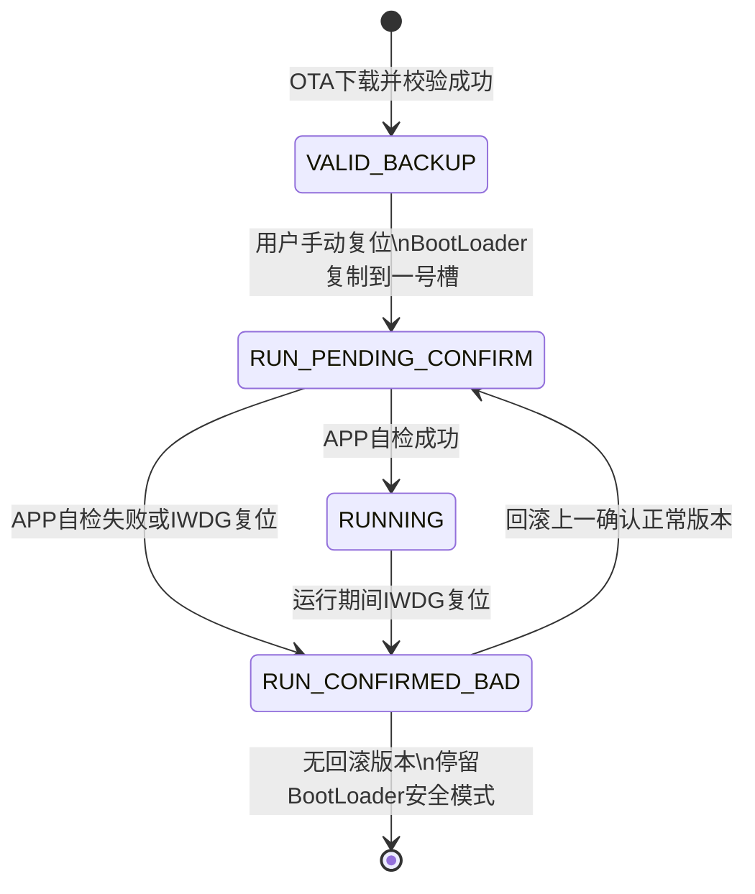

# 上位机 OTA 槽位状态扩展补丁说明

## 1. 补丁信息

| 项目 | 内容 |
| --- | --- |
| 目标仓库 | `https://github.com/aguozimu/PY-MyBootLoader-OTA.git` |
| 补丁基线 | `origin/main`，提交 `070abf7`（archive 2026-11-07 19:39:39） |
| 协议版本 | `OTA-PROTO-1.0.1` |
| 变更类型 | 向后兼容的状态码扩展、状态展示与测试补充 |
| 是否修改帧格式 | 否 |
| 是否新增命令 | 否 |
| 是否修改升级握手 | 否 |
| 是否自动重启设备 | 否 |

本补丁只扩展槽位运行状态的识别和展示，不改变 OTA 下载、分页、CRC、AckCRC 停等重试及最终校验流程。

## 2. 新状态定义

在现有 `0x00~0x07` 后追加三个状态：

| 状态码 | 英文名 | 中文名 | 上位机显示语义 |
| --- | --- | --- | --- |
| `0x08` | `RUN_PENDING_CONFIRM` | 运行待确认 | 新程序已切换并开始运行，等待 APP 自检结果 |
| `0x09` | `RUN_CONFIRMED_OK` | 确认运行正常 | 对应缓存槽中的新程序已通过 APP 自检 |
| `0x0A` | `RUN_CONFIRMED_BAD` | 确认无法运行 | 该程序自检失败或运行期间触发看门狗复位 |

原状态保持不变：

| 状态码 | 名称 | 说明 |
| --- | --- | --- |
| `0x05` | `VALID_BACKUP` | OTA 下载并完成整包校验，等待下一次手动复位切换 |
| `0x06` | `RUNNING` | 当前一号运行槽正在运行；该状态只允许出现在一号槽 |
| `0x07` | `ERROR` | OTA/Flash 操作错误，不等同于“程序已确认无法运行” |

## 3. 设备侧生命周期

需要特别区分：

- `0x05` 表示“已下载成功，但尚未切换”，上位机此时应提示用户手动复位。
- `0x08` 表示“已经切换并正在试运行”，不能视为最终成功。
- `0x06` 表示一号槽正常运行，是上位机 `GetSta` 查询时最常见的成功终态。
- `0x09` 主要保存在本次新程序对应的二/三号缓存槽中，用于后续回滚判定。
- `0x0A` 表示明确运行失败；该标记会保留到对应槽下一次被 OTA 覆盖。

## 4. 上位机行为要求

### 4.1 状态解析

`ota_host/protocol.py` 的 `RUN_STATUS` 和 `RUN_STATUS_ZH` 必须包含三个新状态。接收到未识别状态时仍按原逻辑显示“保留状态”，不得抛异常。

### 4.2 状态展示

运行状态卡增加以下颜色语义：

| 状态码 | 颜色 | 建议文本 |
| --- | --- | --- |
| `0x08` | 警告黄 | 运行待确认 |
| `0x09` | 成功绿 | 确认运行正常 |
| `0x0A` | 错误红 | 确认无法运行 |

上位机仍然只调用现有 `GetSta` 显示一号运行槽状态，不新增三槽查询命令。

### 4.3 OTA 成功判定

最终 OTA 下载是否成功仍然必须同时满足：

1. 设备最终返回 `SetSta/SetEnd` 的 `run_status == 0x05`；
2. 设备返回 16 页 CRC；
3. 15 个程序页最终 CRC 与本地固件一致。

不能把 `0x06/0x08/0x09/0x0A` 中任一状态直接视为“本次 OTA 下载成功”。新状态只描述重启切换后的运行结果。

### 4.4 用户提示

OTA 最终状态为 `0x05` 后，界面应提示：

> 固件已下载并通过校验。请手动复位设备，BootLoader 将切换到新程序；设备重新连接后请再次执行“查询状态”，确认最终为“运行中”或“确认运行正常”。若显示“确认无法运行”，请检查设备是否已自动回滚或进入安全模式。

## 5. 兼容性

- 新上位机连接旧设备：旧设备不会返回 `0x08~0x0A`，行为不变。
- 旧上位机连接新设备：未知状态被解析为 `RESERVED/保留状态`，不会破坏串口事务。
- 协议版本由文档标记为 `OTA-PROTO-1.0.1`，线格式未变化，不需要新增版本协商字段。

## 6. 不包含的内容

- 不新增“确认正常/确认无法运行”的远程设置命令。
- 不新增三槽独立查询接口。
- 不新增自动复位、远程重启或自动升级命令。
- 不改变 `AckCRC`、500 ms 超时和最多 5 次重发规则。
- 不修改设备 APP 的具体业务自检项目；该部分由设备侧后续函数实现。

## 7. 完成标准

- 三个新状态码在协议层、Web 状态卡、中文文本和颜色中一致呈现。
- `0x08` 不再被错误显示为“保留状态”。
- 最终 OTA 成功判定仍严格依赖 `0x05` 与页 CRC。
- 现有 Python 测试全部通过，并新增三个状态的解析与查询展示测试。
- 文档、代码和测试中的状态名称拼写完全一致。