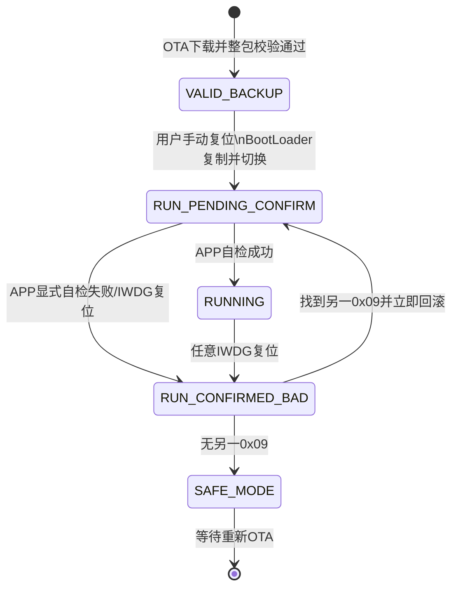

# 设备 OTA 槽位状态扩展补丁说明

## 1. 补丁信息

| 项目 | 内容 |
| --- | --- |
| 目标仓库 | `https://github.com/aguozimu/STM32-F103C8T6-BootLoader-OTA.git` |
| 补丁基线 | `origin/main`，提交 `d377741`（archive 2026-11-08 17:24） |
| 协议版本 | `OTA-PROTO-1.0.1` |
| MCU | STM32F103C8T6，64 KB Flash |
| 运行区 | 一号槽 `0x08004000~0x08007FFF` |
| 升级缓存槽 | 二号槽 `0x08008000~0x0800BFFF`、三号槽 `0x0800C000~0x0800FFFF` |
| 是否修改帧格式 | 否 |
| 是否新增协议命令 | 否 |
| 是否自动重启 | 否，用户下一次手动复位触发切换 |

本补丁增加三个槽位运行状态，并补齐 BootLoader 从二/三号缓存槽切换到一号运行区、APP 自检确认、IWDG 判坏和自动回滚的闭环。

## 2. 新状态定义

| 状态码 | 名称 | 中文 | 写入位置 |
| --- | --- | --- | --- |
| `0x08` | `RUN_PENDING_CONFIRM` | 运行待确认 | 一号槽和本次对应缓存槽 |
| `0x09` | `RUN_CONFIRMED_OK` | 确认运行正常 | 本次对应缓存槽 |
| `0x0A` | `RUN_CONFIRMED_BAD` | 确认无法运行 | 一号槽和对应缓存槽 |

原有状态保持不变：

| 状态码 | 名称 | 说明 |
| --- | --- | --- |
| `0x05` | `VALID_BACKUP` | OTA 下载及整包校验成功的待切换镜像 |
| `0x06` | `RUNNING` | 一号槽正常运行；不得写入二、三号槽 |
| `0x07` | `ERROR` | OTA、Flash 或镜像完整性错误，不等同于 `0x0A` |

状态记录仍为四字节小端：

```text
[Run_status][Page][Block][Error]
```

本补丁不新增错误码。程序自检失败或看门狗重启属于“槽状态”变化，`Error_code` 可为 `0x00`，由上位机根据 `0x0A` 展示明确结论。

## 3. 完整状态转换



### 3.1 OTA 下载阶段

1. 上位机发送控制页和差异程序页。
2. 设备继续按现有逻辑写入二或三号缓存槽。
3. 最终 `SetEnd` 验证全部 15 个程序页和控制页 CRC。
4. 验证成功后缓存槽写 `0x05 VALID_BACKUP`，不自动重启。
5. 用户下一次断电/复位后，BootLoader 才执行切换。

### 3.2 正常切换

1. BootLoader 扫描二、三号槽，选择最新的有效 `0x05`。
2. 校验控制页自身 CRC、页地址、15 个程序页 CRC。
3. 将 15 KB 程序数据复制到一号槽并逐页回读验证。
4. 一号槽控制页改为 `0x08`，16 个地址改为对应实际槽地址，ID 使用候选镜像 ID。
5. 对应缓存槽也改为 `0x08`，保留原绝对地址信息。
6. 跳转一号槽 APP。
7. APP 完成自身检测函数后调用成功接口：
   - 一号槽写 `0x06 RUNNING`；
   - 对应缓存槽写 `0x09 RUN_CONFIRMED_OK`；
   - 另一个非 `0x0A`、且不是进行中升级的缓存槽写 `0x00 EMPTY`。

### 3.3 失败与回滚

触发条件：

- APP 显式调用失败接口；
- APP 试运行期发生 IWDG 复位；
- 已处于 `0x06` 的程序运行期间发生任意 IWDG 复位。

处理顺序：

1. BootLoader 根据复位标志进入 IWDG 处理分支。
2. 将一号槽状态写为 `0x0A`。
3. 找到与一号槽 ID 和 16 页 CRC 均匹配的源缓存槽，将其写为 `0x0A`。
4. 从其余缓存槽中选择最新 `0x09` 作为回滚源。
5. 验证回滚源后复制到一号槽。
6. 一号槽和回滚源槽都写 `0x08`，立即跳转回滚 APP。
7. 回滚 APP 自检成功后，按正常成功规则写 `0x06/0x09`。
8. 原 `0x0A` 槽保持失败标记，直到下一次 OTA 选择该槽覆盖。

若找不到其它 `0x09`：

- 一号槽维持 `0x0A`；
- BootLoader 停留安全模式并持续喂狗；
- 等待上位机重新 OTA，不循环跳转坏程序。

### 3.4 掉电恢复

- 复制过程中按页刷新 IWDG。
- 先复制程序页，再写一号槽控制页，最后写源槽控制页。
- 一号槽控制页是切换提交点。
- 若程序页复制或回读失败，不跳转 APP，可尝试下一候选或进入安全模式。
- 若在源槽改 `0x08` 前掉电，源槽仍为 `0x05`，下次复位可安全重复复制。
- 若一、二号状态不一致，BootLoader 以一号槽为当前运行事实，并依据 ID、CRC 和两侧状态完成归一化。

## 4. 选槽规则

### 4.1 激活候选

- 只选择状态 `0x05` 的缓存槽。
- 多个候选时按 16 位程序 ID 回绕规则选择较新者。
- ID 相同选择较低槽号（二号优先）。
- 控制页 CRC 或任一程序页 CRC 无效的候选不得启动；可标记为 `0x07 ERROR` 后尝试下一候选。

### 4.2 回滚候选

- 只选择状态 `0x09` 且未被本次判坏的缓存槽。
- 多个候选按程序 ID 的新旧规则选择最新者。
- `0x0A`、`0x00`、`0x05` 不能作为立即回滚源；其中 `0x05` 应走正常激活流程。

### 4.3 OTA 写入目标槽

下一次 OTA 应优先覆盖：

1. `0x0A CONFIRMED_BAD`；
2. `0x00 EMPTY`；
3. `0x07 ERROR`；
4. 必要时选择较旧的有效备用槽。

不得覆盖当前唯一 `0x09`，除非没有其它可写槽并已满足现有安全规则。

## 5. APP 自检接口约定

具体业务检测项由后续 APP 代码决定，本次补丁只提供可靠接口和调用位置：

```c
void FlashManage_ConfirmRunning(void);
void FlashManage_RejectRunning(void);
```

- `FlashManage_ConfirmRunning()`：在全部初始化及业务自检通过后调用。
- `FlashManage_RejectRunning()`：在明确检测失败时调用，内部写 `0x0A` 后可触发系统复位或等待 IWDG。
- 两接口必须幂等；如果状态已经正确，不重复擦写 Flash。
- 未接入检测函数时，程序保持 `0x08`，上位机显示“运行待确认”。

## 6. 兼容与边界

- `0x06` 只允许出现在一号槽。
- 二、三号槽可以写 `0x08/0x09/0x0A`，不得写 `0x06`。
- `0x09` 只表示缓存槽中已验证可运行的镜像，不等同于当前正在运行。
- `0x0A` 保留失败结论，不在回滚成功后自动清除。
- 本补丁不引入第三个程序槽、不改变 Flash 分区、不改变 16 字节帧。
- 不新增远程重启命令；升级结果仍为 `0x05`，由用户手动复位切换。
- 旧上位机可能把 `0x08~0x0A` 显示为保留状态，但设备流程不受影响。

## 7. 完成标准

- OTA 校验成功后缓存槽为 `0x05`，用户手动复位后才切换。
- 切换后一号槽和源槽都进入 `0x08`。
- APP 自检成功后一号槽为 `0x06`、源槽为 `0x09`。
- APP 显式失败和任意 IWDG 复位都会把当前运行版本及其匹配源槽标为 `0x0A`。
- 存在其它 `0x09` 时立即自动回滚并进入 `0x08` 试运行。
- 无回滚版本时停留安全模式，不反复启动坏程序。
- `0x0A` 保留到对应槽被下一次 OTA 覆盖。